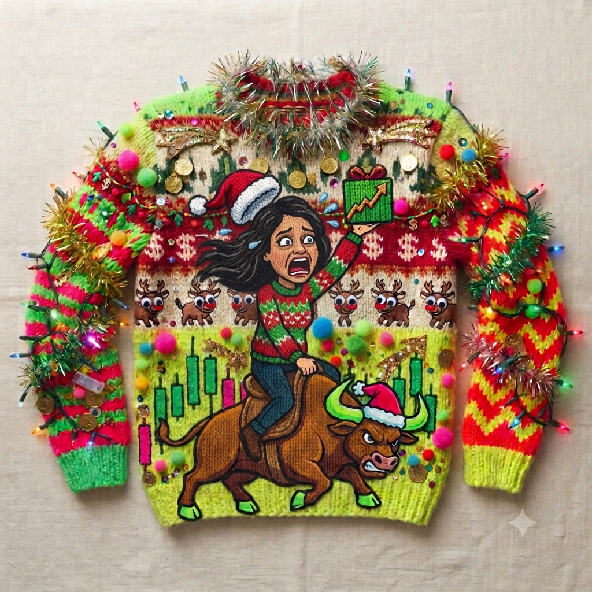
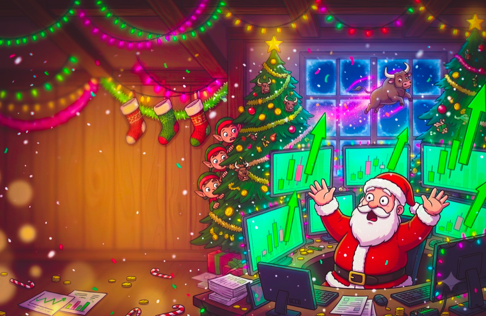
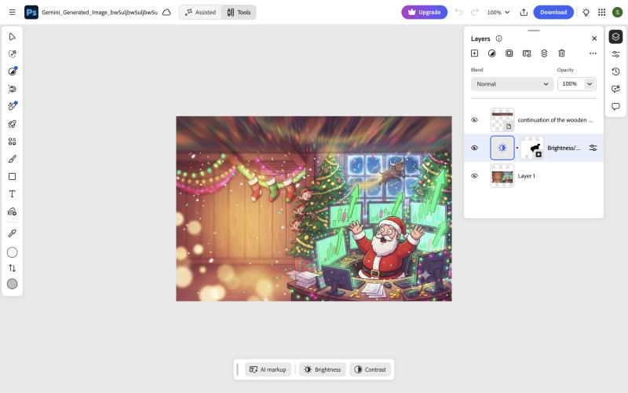

# 🐂🎄 Bull Market Christmas

**My entry for [Deck the Pixels](https://deckthepixels.devpost.com) — an ugly holiday sweater and matching holiday card made with Nano Banana and Adobe Photoshop.**

> *Scared of the ride. Never letting go of the gains.*

---

## The sweater

My avatar — a girl who dreams of Wall Street — rides a charging bull in total panic, Santa hat flying off, while holding up a green stock-chart gift. Around her: candlestick charts shaped like Christmas trees, gold-coin ornaments, dollar-sign snowflakes, googly-eyed reindeer, tinsel, blinking lights and mismatched sleeves.

## The holiday card

Even Santa can't handle the bull market. He throws his hands up at his trading desk as green charts rocket upward, nervous elves peek out from behind the tree, and a bull flies past the window.

---

## Inspiration

Ever since I started studying finance, Wall Street has felt like a dream place to me — the energy, the screens full of charts, and the famous bull that stands for a rising market. But it also comes with a lot of fear: *Is this real? Should I hold? Will it crash?*

A bull market is like riding a wild bull — thrilling, crazy, and a little terrifying. So I imagined myself riding that bull in total panic, still holding on tight to my gains like a Christmas gift.

## How I built it

1. **Idea** — turned the feeling of loving Wall Street but fearing the ride into a sweater story.
2. **Sweater (Nano Banana)** — designed it over several rounds, pushing it uglier each time.
3. **The rider (Nano Banana)** — put a girl on the bull and chose a fear face over a happy one, because fear is the real story.
4. **My avatar (Nano Banana in Adobe Firefly)** — used my own photo as a reference so the rider looks like me.
5. **Card (Nano Banana)** — built a Santa scene that continues the sweater's joke.
6. **Finishing (Adobe Photoshop)** — Generative Fill to rebuild the ceiling, plus an adjustment layer to make the lights and charts glow.

## Tools

Nano Banana · Adobe Photoshop (Generative Fill, adjustment layers) · Adobe Firefly

## Files

| File | What it is |
|---|---|
| `1_Sweater_Bull_Market_Christmas.png` | Final sweater design |
| `2_Card_Bull_Market_Christmas.png` | Final holiday card |
| `3_Photoshop_Layers_Screenshot.png` | Photoshop file with the Layers panel |
